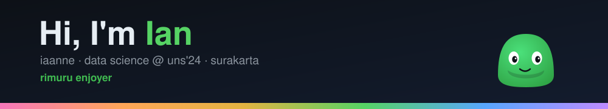

<!--
  Profile README for @iaanne.
  assets/aquarium.svg is generated by assets/gen_aquarium.py: edit the FISH list there and re-run it.
  Each fish is a repository, the size comes from its star count.
-->

  

  

  <code>fish = repositories</code> · <code>size = stars</code> · <code>seaweed = the urge to self-host</code>

## 🧠 About Me

- 🎓 Undergraduate **Data Science** student, UNS'24
- 📈 Focus: **Machine Learning** — currently learning
- 🛠 Daily tools: Python, SQL (PostgreSQL / SQL Server), Neovim, Linux, Podman
- 🔧 Into: self-hosting, dotfiles, and the Linux desktop

## 🐠 In the Tank

| Repo | What it is | Stack |
| --- | --- | :---: |
| [rsi-penugasan4-kelompok1](https://github.com/iaanne/rsi-penugasan4-kelompok1) | RSI group assignment 4 | TypeScript |
| [rsi-penugasan2-kelompok1](https://github.com/iaanne/rsi-penugasan2-kelompok1) | RSI group assignment 2 | Python |
| [rsi-penugasan1-kelompok1](https://github.com/iaanne/rsi-penugasan1-kelompok1) | RSI group assignment 1 | TypeScript |
| [ml-bisindo-multimodal-keypoint-caption](https://github.com/iaanne/ml-bisindo-multimodal-keypoint-caption) | BISINDO sign language captioning from keypoints | Python |
| [dabd-eurointellegence](https://github.com/iaanne/dabd-eurointellegence) | Euro intelligence data pipeline | Python |
| [bi-olist-crm-dashboard](https://github.com/iaanne/bi-olist-crm-dashboard) | Olist CRM dashboard | Python |
| [kbr-notaris-triage-kelompok3](https://github.com/iaanne/kbr-notaris-triage-kelompok3) | Notary document triage | Python |
| [cloud-usgs-earthquake](https://github.com/iaanne/cloud-usgs-earthquake) | USGS earthquake feed on cloud infra | Shell |
| [midnight-shell](https://github.com/iaanne/midnight-shell) | Caelestia + Niri shell (fork) | QML |

36 public repos, mostly Python and notebooks. The small unlabelled fish in the tank are the rest of them.

## 🛠 Languages & Tools

  
  
  
  
  
  
  

## 📊 GitHub Activity

  
  

  <picture>
    <source media="(prefers-color-scheme: dark)" srcset="https://raw.githubusercontent.com/iaanne/iaanne/output/pacman-contribution-graph-dark.svg">
    <source media="(prefers-color-scheme: light)" srcset="https://raw.githubusercontent.com/iaanne/iaanne/output/pacman-contribution-graph.svg">
    
  </picture>

  
   
  🟢 thanks for stopping by

