## Peta proyek

## Tentang

Mahasiswa Sains Data di Universitas Sebelas Maret. Keseharianku berputar pada
perancangan pipeline data, pelatihan model, dan merapikan hasilnya jadi dasbor
yang bisa dibaca orang lain.

- **Fokus sekarang:** machine learning, data pipeline, dan representasi pengetahuan.
- **Perkakas harian:** Python, SQL (PostgreSQL dan SQL Server), Neovim, Linux, Podman.
- **Di luar kuliah:** mengubah tampilan desktop Linux dan membaca dokumentasi orang.

## Yang sedang dikerjakan

| Repo | Isi |
| --- | --- |
| [EuroGrid Intelligence](https://github.com/iaanne/dabd-eurointellegence) | Platform data kelistrikan Eropa: ingest ke Bronze, Iceberg di Garage S3, Prefect harian |
| [Notaris Triage](https://github.com/iaanne/kbr-notaristriage) | Ontologi OWL DL hak atas tanah, 10 query SPARQL, chatbot slot-filling |
| [Pipeline Saham IHSG](https://github.com/iaanne/ipbd-tbp-kelompok7) | Spark, Kafka, Prefect, Trino, dan Garage S3 untuk prediksi IHSG 6000 |
| [CRM Insight Olist](https://github.com/iaanne/bi-olist-crm-dashboard) | Dasbor Streamlit tujuh halaman untuk enam pertanyaan bisnis |

## Proyek pilihan

| Proyek | Ringkas | Stack |
| --- | --- | --- |
| [Chatbot RAG Resep Masakan](https://github.com/iaanne/nlp-rag-LLMMenuMasakanIndonesia) | Jawaban dari 10.000+ resep Cookpad, selalu dengan sitasi sumber | Python, Qdrant, BM25, Gemini, Streamlit |
| [Monitoring Dedolarisasi ASEAN](https://github.com/iaanne/rosbd-finalproject-kelompok4) | Dasbor real-time mata uang ASEAN dengan clustering dan alert Telegram | Kafka, Spark, Cassandra, FastAPI, React |
| [Caption BISINDO Multimodal](https://github.com/iaanne/ml-bisindo-multimodal-keypoint-caption) | Rencana penggabungan keypoint dan modalitas lain, kode masih tahap awal | Python |
| [Ingesti Gempa USGS](https://github.com/iaanne/cloud-usgs-earthquake) | Azure Data Factory menarik katalog gempa ke Data Lake Bronze | Azure, Shell |
| [SIPANDA Learning Platform](https://github.com/iaanne/RSI_Learning_Platform_Website) | Materi, kuis adaptif, dan dasbor per peran dalam satu aplikasi Next.js | Next.js, TypeScript, Prisma, PostgreSQL |
| [Katalog Film IMDb](https://github.com/iaanne/imdb-showfy) | Pencarian judul, genre, dan daftar tontonan berbasis Laravel | Laravel, PHP, Blade |
| [Portofolio](https://github.com/iaanne/portfolio) | Situs portofolio React + Vite, terbit di GitHub Pages | TypeScript, React, Tailwind |

## Perkakas

  
  
  
  
  
  
  

## Aktivitas

  
  

  <picture>
    <source media="(prefers-color-scheme: dark)" srcset="https://raw.githubusercontent.com/iaanne/iaanne/output/pacman-contribution-graph-dark.svg">
    <source media="(prefers-color-scheme: light)" srcset="https://raw.githubusercontent.com/iaanne/iaanne/output/pacman-contribution-graph.svg">
    
  </picture>

  Gambar peta dan akuarium dibuat dari daftar repo publik, jadi ikut berubah saat repo bertambah.

