## Peta proyek

## Tentang

Halo, aku Ian
Mahasiswa Sains Data di Universitas Sebelas Maret. Keseharianku berputar pada
perancangan Pipeline data, Pelatihan model, dan merapikan hasilnya jadi Dashboard
yang bisa dibaca orang lain.

- **Fokus sekarang:** Machine learning, Data pipeline, dan Representasi pengetahuan.
- **Perkakas harian:** Python, PostgreSQL, Neovim, Linux, Podman.
- **Di luar kuliah:** Eksplorasi Linux dan membaca update seputar AI.

## Aktivitas

  

  

