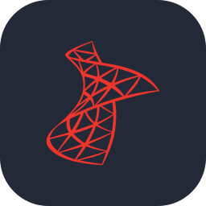
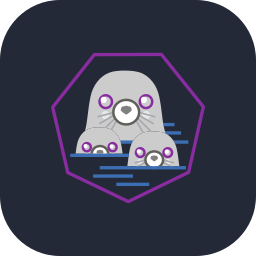

<!--
  Profile README for @iaanne.
  assets/aquarium.svg      -> gen_aquarium.py      (every repo becomes a fish)
  assets/project_map.svg   -> gen_project_map.py   (repos grouped into routes)
  Re-run either generator after adding repositories; both read repos.json.
-->

<table width="100%">
<tr>
<td width="64%" valign="middle">

SIGNAL BRIEF · iaanne

<h1>ian</h1>
<h2>Data Science · Machine Learning</h2>

<strong>● Building and sharing work in public</strong>

Surakarta, Jawa Tengah · Universitas Sebelas Maret

<a href="https://github.com/iaanne">GitHub</a>

</td>
<td width="36%" valign="middle" align="center">

</td>
</tr>
</table>

## What teams can evaluate quickly

<table width="100%">
<tr>
<td width="33%" valign="top"><h3>Role fit</h3>
Data Science · machine learning · Python, SQL, notebooks
</td>
<td width="33%" valign="top"><h3>Public proof</h3>
35 repositories · 3 stars · 9 languages
</td>
<td width="33%" valign="top"><h3>Works in the open</h3>
Course projects, group builds, and a self-hosted Linux desktop
</td>
</tr>
</table>

## Proof at a glance

<table width="100%">
<tr>
<td width="25%" align="center"><strong>35</strong> Repositories</td>
<td width="25%" align="center"><strong>3</strong> Stars</td>
<td width="25%" align="center"><strong>17</strong> Followers</td>
<td width="25%" align="center"><strong>9</strong> Languages</td>
</tr>
</table>

  
  

## The tank

  

every repository is a fish · the size follows the star count · the small ones are the coursework

## Selected work · project map

  

five routes: web, data &amp; ML, notebooks, PHP, systems

<table width="100%">
<tr>
<td width="50%" valign="top">
<h3><a href="https://github.com/iaanne/ml-bisindo-multimodal-keypoint-caption">ml-bisindo-multimodal-keypoint-caption</a></h3>

Sign language captioning from keypoints: the current machine learning build.

<a href="https://github.com/iaanne/ml-bisindo-multimodal-keypoint-caption">Read the repository →</a>

</td>
<td width="50%" valign="top">
<h3><a href="https://github.com/iaanne/dabd-eurointellegence">dabd-eurointellegence</a></h3>

Data pipeline work on a European intelligence dataset.

<a href="https://github.com/iaanne/dabd-eurointellegence">Read the repository →</a>

</td>
</tr>
<tr>
<td width="50%" valign="top">
<h3><a href="https://github.com/iaanne/rsi-penugasan4-kelompok1">rsi-penugasan4-kelompok1</a></h3>

Systems-integration group assignment, the most starred repo here.

<a href="https://github.com/iaanne/rsi-penugasan4-kelompok1">Read the repository →</a>

</td>
<td width="50%" valign="top">
<h3><a href="https://github.com/iaanne/bi-olist-crm-dashboard">bi-olist-crm-dashboard</a></h3>

Business intelligence dashboard over the Olist CRM dataset.

<a href="https://github.com/iaanne/bi-olist-crm-dashboard">Read the repository →</a>

</td>
</tr>
</table>

## Technical toolkit

  
  
  
  
  
  
  

<table width="100%">
<tr>
<td width="20%" align="center"><strong>Python</strong> 10 repos</td>
<td width="20%" align="center"><strong>Jupyter</strong> 5 repos</td>
<td width="20%" align="center"><strong>TypeScript</strong> 3 repos</td>
<td width="20%" align="center"><strong>PHP</strong> 2 repos</td>
<td width="20%" align="center"><strong>Shell · QML</strong> 1 repo each</td>
</tr>
</table>

## Consistency signal

  <picture>
    <source media="(prefers-color-scheme: dark)" srcset="https://raw.githubusercontent.com/iaanne/iaanne/output/pacman-contribution-graph-dark.svg">
    <source media="(prefers-color-scheme: light)" srcset="https://raw.githubusercontent.com/iaanne/iaanne/output/pacman-contribution-graph.svg">
    
  </picture>

<table width="100%">
<tr>
<td width="62%" valign="middle"><h2>Let's talk about the next build</h2>
Open to collaboration, campus projects, and useful engineering work.
</td>
<td width="38%" valign="middle" align="right"><a href="https://github.com/iaanne">GitHub</a></td>
</tr>
</table>

ian · the tank and the map are hand-written SVG, redrawn from this profile's public repository data

